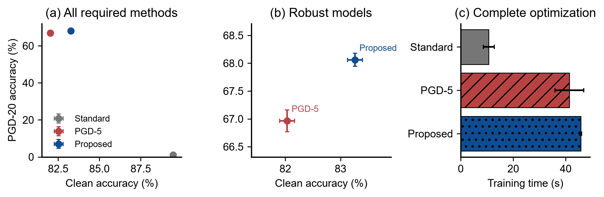
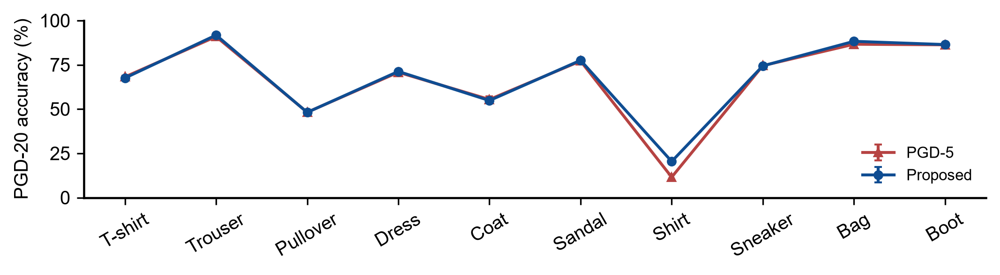
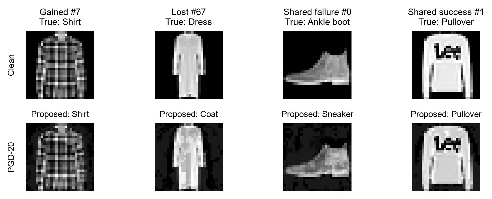

Adversarial Consistency with a Perturbation Curriculum on Fashion-MNIST

CISC7404-002 Trustworthy AI · Coursework 1MC647418 · University of Macau

Abstract

I study whether label-guided adversarial training benefits from prediction consistency and a gradual increase in perturbation strength. The final method combines clean and adversarial cross-entropy, a KL consistency penalty, a ten-epoch radius curriculum and late parameter averaging. All experiments use the prescribed 784–256–128–10 network. Across five new confirmation seeds, the method obtains 83.26% clean accuracy and 68.06% accuracy under the official PGD-20 attack. Compared with conventional PGD training, these are gains of 1.23 and 1.10 percentage points, with 10.4% more optimization time. A factorial comparison separates consistency, curriculum and averaging. Additional attacks use cross-entropy and logit-margin objectives, three restarts and every intermediate iterate. The study contains 22 validation development runs and 30 confirmatory optimization runs; the records also retain unsuccessful loss and attack-budget choices.

## 1 Motivation and research question

The coursework asks for a balance among robustness, clean accuracy and computational cost. Conventional PGD training supplies a clear robustness baseline [2], but its adversarial cross-entropy objective does not directly preserve predictions on the original image. Adding clean supervision is a useful first control. I then ask whether the two predictions should also agree over all ten classes, and whether introducing the full perturbation radius gradually makes this objective easier to optimize.

My loss keeps the true label active on both clean and adversarial inputs. A consistency term supplies a separate signal about their full output distributions. This follows the prediction-stability idea in TRADES [3], while retaining cross-entropy attacks and explicit adversarial label supervision. The radius schedule changes the early optimization problem; averaging changes the final parameters used for inference. Each choice has a corresponding control.

The research question is therefore: under the fixed model, optimizer and thirty-epoch budget, can consistency and continuation improve both clean and PGD-20 accuracy, and which component pays for the additional computation? I assess this with a validation-only configuration search, five paired training seeds, a complete component comparison and stronger attacks. The contribution is the tested combination and its controlled analysis, rather than a claim of a new general-purpose defense.

<!-- page break -->

## 2 Proposed training procedure

Let fθ(x) denote ten logits, pθ(x) their softmax distribution and ℓθ(x,y) the cross-entropy with the true label. Pixels are in [0,1]. The feasible attack region and the label-guided PGD update are

$$
\mathcal{B}_{\infty}(x,\varepsilon)=\{z\in[0,1]^{784}:\|z-x\|_{\infty}\leq\varepsilon\}
$$

$$
x^{t+1}=\Pi_{\mathcal{B}_{\infty}(x,\varepsilon_e)}\!\left(x^t+\alpha_e\operatorname{sign}\!\left(\nabla_{x^t}\ell_{\theta}(x^t,y)\right)\right)
$$

Every minibatch starts from independent uniform noise in [−εe,εe], clipped to the pixel domain. I use five attack steps throughout training. The epoch index e starts at one; the curriculum reaches the target threat radius at epoch ten [4]:

$$
\varepsilon_e=0.10\min\!\left(1,\frac{e}{10}\right),\qquad\alpha_e=\frac{\varepsilon_e}{4},\qquad K=5
$$

With xadv detached from the inner search, the minibatch mean of the following loss updates the model:

$$
\mathcal{L}_{\theta}=0.25\ell_{\theta}(x,y)+0.75\ell_{\theta}(x_{\mathrm{adv}},y)+0.5D_{\mathrm{KL}}\!\left(p_{\theta}(x)\Vert p_{\theta}(x_{\mathrm{adv}})\right)
$$

The KL term is KL(clean || adversarial). Both distributions retain their model-gradient paths in the outer loss. The attack maximizes label cross-entropy, so the clean distribution is not used as an attack target. Explicit adversarial supervision still supplies the correct label when a clean prediction is wrong. The penalty encourages local agreement without replacing that supervision.

The saved inference model averages the ten epoch-end parameter states from epochs 21–30. Temporal averaging has been applied to adversarial training [5]; here I use a plain arithmetic average under the common Adam/cosine schedule:

$$
\bar\theta=\frac{1}{10}\sum_{e=21}^{30}\theta_e
$$

| Step | Operation |
| --- | --- |
| 1 | Set the epoch radius and generate five-step CE-PGD examples |
| 2 | Backpropagate the mixed cross-entropy plus KL consistency loss |
| 3 | Update Adam; after epochs 21–30, update the running parameter mean |

Algorithm 1. Averaging does not feed back into training or attack generation. Inference uses one 235,146-parameter MLP; no ensemble is evaluated.

<!-- page break -->

## 3 Experimental setup and validation selection

Fashion-MNIST contains 60,000 training and 10,000 test images [1]. I reserve 500 training images per class for validation, using a stratified split with seed 7404. The remaining 55,000 images train every model. Inputs are divided by 255; I use no augmentation, external data or pretrained weights. All methods keep Flatten → Linear(784,256) → ReLU → Linear(256,128) → ReLU → Linear(128,10).

| Setting | Value |
| --- | --- |
| Optimization | 30 epochs; batch 256; Adam, lr 0.001, weight decay 0.0001 |
| Adam / schedule | Betas (0.9, 0.999), eps 1e-8; cosine decay to lr 1e-5 |
| Confirmation seeds | 7411, 7412, 7413, 7414, 7415; same initialization and batch order per seed |
| Standard / PGD baselines | Clean CE / adversarial CE; PGD-5, ε 0.10, α 0.025, random start |
| Official evaluation | Full 10,000 test images; CE-PGD-20, ε 0.10, α 0.01, one random start |
| Hardware / precision | NVIDIA RTX 4060, 8 GB; float32; TF32 off; deterministic operations; 4 CPU threads |

Table 1. Evaluation uses model.eval(), attack seed 9001 and batches of 512. Model parameters are not updated during attacks.

I evaluated 22 development configurations for thirty epochs at seed 7404. A PGD validation reference has 82.74% clean accuracy. The selection rule requires at least 83.74% clean accuracy; among configurations within 0.20 points of the best eligible PGD-20 accuracy, it chooses the shortest measured training time. The selected configuration is frozen before evaluating the five new confirmation seeds.

| Development configuration | Clean (%) | PGD-20 (%) |
| --- | --- | --- |
| Mixed CE | 84.66 | 67.22 |
| TRADES, β=4 | 83.86 | 67.44 |
| MART, β=2 | 81.82 | 67.24 |
| Mixed CE + curriculum + average | 84.90 | 67.48 |
| Consistency + curriculum + average | 84.18 | 68.18 |
| Confidence-weighted penalty, λ=1 | 83.98 | 68.08 |
| Two early attack steps | 84.16 | 67.50 |

Table 2. Selected validation comparisons; all 22 configurations and costs are retained in the experiment ledger. TRADES tests β in {1,2,4,6}; MART is the tested β=2 reference [3,7].

An earlier completed study had already evaluated the test set. This revision selects configurations only on held-out validation and uses new confirmation seeds; test outcomes do not change the frozen configuration. Every reported model uses its predetermined final raw or averaged state, with no test-based checkpoint selection.

<!-- page break -->

## 4 Main results and the cost of the gain

| Method | Training time (s) | Clean (%) | PGD-20 (%) |
| --- | --- | --- | --- |
| Standard training | 10.67 ± 2.10 | 89.45 ± 0.13 | 1.10 ± 0.39 |
| PGD adversarial training | 41.41 ± 5.48 | 82.03 ± 0.14 | 66.97 ± 0.20 |
| Proposed method | 45.71 ± 0.41 | 83.26 ± 0.13 | 68.06 ± 0.12 |

Table 3. Required full-test comparison, mean ± sample SD over five seeds. All models receive thirty epochs on the same equipment.

The proposed method improves clean accuracy by 1.23 points and official PGD-20 accuracy by 1.10 points relative to PGD training. Training takes 10.4% longer. Clean accuracy remains 6.19 points below standard training. Mean epoch times are 0.355 s for standard training, 1.380 s for PGD and 1.523 s for the proposal. The method buys a better accuracy trade-off with additional computation; it keeps five attack steps.

Figure 1. Clean/robust trade-off, its magnified robust region and measured training cost. Error bars show SD across training seeds.

| Seed | Clean gain (pp) | Robust gain (pp) | Gained / lost images |
| --- | --- | --- | --- |
| 7411 | +1.11 | +0.99 | 267 / 168 |
| 7412 | +1.10 | +1.16 | 273 / 157 |
| 7413 | +1.56 | +1.14 | 276 / 162 |
| 7414 | +1.33 | +0.93 | 280 / 187 |
| 7415 | +1.04 | +1.26 | 285 / 159 |

Table 4. Paired comparison with PGD. Each method attacks its own model under the same official protocol; image identities are paired.

The paired robustness gain is positive in 5/5 seeds. Its 95% Student t interval across seeds is [0.93, 1.26] points. This interval measures seed variation for the fixed data and protocol. Gains and losses also show that an overall improvement does not repair every example.

Timing includes synchronized adversarial generation, all forwards/backwards, optimizer updates, averaging and epoch logs. Preparation, transfer, warmup, serialization and validation/evaluation are outside the timer. Method order rotates between seeds. Desktop runtime varies appreciably, so the measured mean cost difference is not a precise hardware-independent estimate.

<!-- page break -->

## 5 Component analysis and class dependence

| KL penalty | Curriculum | Average | Clean (%) | PGD-20 (%) |
| --- | --- | --- | --- | --- |
| No | No | No | 83.66 ± 0.18 | 67.49 ± 0.26 |
| No | No | Yes | 83.58 ± 0.20 | 67.43 ± 0.24 |
| No | Yes | No | 84.11 ± 0.06 | 67.38 ± 0.10 |
| No | Yes | Yes | 84.05 ± 0.09 | 67.28 ± 0.19 |
| Yes | No | No | 82.69 ± 0.16 | 67.77 ± 0.31 |
| Yes | No | Yes | 82.70 ± 0.16 | 67.66 ± 0.36 |
| Yes | Yes | No | 83.30 ± 0.06 | 68.17 ± 0.19 |
| Yes | Yes | Yes | 83.26 ± 0.13 | 68.06 ± 0.12 |

Table 5. Full 2×2×2 comparison, five paired seeds. Every row keeps 25% clean and 75% adversarial CE. Raw and averaged states share the same optimization trajectory, so eight outcomes require four training runs per seed.

With the radius fixed, consistency changes robustness by +0.29 points. With consistency and averaging present, the curriculum contributes +0.40 points. Averaging the proposed trajectory changes robustness by -0.11 points and reduces observed seed SD from 0.19 to 0.12 points. The raw curriculum–consistency interaction is +0.50 points; their effects are not simply additive.

Figure 2. Official class-wise robustness, mean ± SD. Every class has 1,000 test images; the disparity is not a test-class imbalance [9].

Shirt remains the weakest class at 20.42% robustness. The 8.86-point gain for Shirt accounts for 80.8% of the overall increase because test classes are equally sized. Most of the gain therefore comes from one class. The saved tables and confusion matrices expose the remaining errors.

The development search explains several exclusions. TRADES β=1 improves clean validation accuracy to 86.98% but reaches 63.92% under PGD-20. The tested MART setting reaches 67.24% robustness and 81.82% clean accuracy, missing the clean floor. A detached clean-confidence weight on the KL penalty reaches 68.08% robustness at λ=1, without beating the chosen trade-off. Reducing the first ten epochs to two attack steps lowers robustness from 68.18% to 67.50%; I retain five steps.

Development uses 19.21 minutes of optimization; confirmation uses 19.56 minutes. A fixed 1,000-image validation trace every five epochs adds 0.20 minutes separately. A fresh proposed seed-7411 repeat reproduces both parameter states and all 10,000 official predictions exactly. Search cost is separate from Table 3.

<!-- page break -->

## 6 Stronger attacks, failures and conclusion

| Method | PGD-20 (%) | CE-PGD-50 ×3 (%) | Attack union (%) |
| --- | --- | --- | --- |
| Standard | 1.10 | 0.84 | 0.81 |
| PGD-5 | 66.97 | 66.28 | 65.28 |
| Proposed | 68.06 | 67.33 | 66.42 |

Table 6. Full test, averaged across five seeds. The union includes official PGD-20 plus CE and margin PGD-50, each with α=0.005 and three restarts. Any failed intermediate iterate counts as a failure.

The stronger audit gives 66.42% accuracy for the proposal and 65.28% for PGD training, a +1.14-point difference. Comparing attack objectives and retaining every successful iterate checks whether the official gain survives a broader search [8]. These are empirical attacks, not a certificate. An additional ε sweep is retained in the notebook and figures.

Figure 3. First seed-7411 example in each declared outcome category. Rows show clean pixels and the proposal's official attack. Lost and shared-failure cases are correctly classified before attack.

The gained example illustrates an image for which the PGD baseline fails but the proposal survives its own white-box attack. The lost example shows the reverse. I select the first qualifying index in each category to keep the rule reproducible. These examples illustrate particular decisions; the full-test counts determine the aggregate conclusion.

The tested combination improves clean accuracy by 1.23 points and PGD-20 accuracy by 1.10 points, at 10.4% extra optimization cost. The component controls locate the gain, while stronger attacks and failed examples bound the claim. Limits are the fixed small MLP, one dataset, five seeds, a single development seed and a finite validation search. Robust overfitting and parameter averaging merit longer-budget study [6]; the present evidence supports this thirty-epoch setting.

<!-- page break -->

## References

[1] Han Xiao, Kashif Rasul and Roland Vollgraf. Fashion-MNIST: a Novel Image Dataset for Benchmarking Machine Learning Algorithms. arXiv:1708.07747, 2017.https://arxiv.org/abs/1708.07747

[2] Aleksander Madry, Aleksandar Makelov, Ludwig Schmidt, Dimitris Tsipras and Adrian Vladu. Towards Deep Learning Models Resistant to Adversarial Attacks. arXiv:1706.06083, 2017.https://arxiv.org/abs/1706.06083

[3] Hongyang Zhang, Yaodong Yu, Jiantao Jiao, Eric Xing, Laurent El Ghaoui and Michael I. Jordan. Theoretically Principled Trade-off between Robustness and Accuracy. ICML, PMLR 97:7472–7482, 2019.https://proceedings.mlr.press/v97/zhang19p.html

[4] Qi-Zhi Cai, Min Du, Chang Liu and Dawn Song. Curriculum Adversarial Training. arXiv:1805.04807, 2018.https://arxiv.org/abs/1805.04807

[5] Joong-Won Hwang, Youngwan Lee, Sungchan Oh and Yuseok Bae. Adversarial Training with Stochastic Weight Average. arXiv:2009.10526, 2020.https://arxiv.org/abs/2009.10526

[6] Leslie Rice, Eric Wong and J. Zico Kolter. Overfitting in Adversarially Robust Deep Learning. ICML, PMLR 119:8093–8104, 2020.https://proceedings.mlr.press/v119/rice20a.html

[7] Yisen Wang, Difan Zou, Jinfeng Yi, James Bailey, Xingjun Ma and Quanquan Gu. Improving Adversarial Robustness Requires Revisiting Misclassified Examples. ICLR, 2020.https://openreview.net/pdf/08f03663964e4c8da165be864d32eed9723ef6fa.pdf

[8] Anish Athalye, Nicholas Carlini and David Wagner. Obfuscated Gradients Give a False Sense of Security: Circumventing Defenses to Adversarial Examples. arXiv:1802.00420, 2018.https://arxiv.org/abs/1802.00420

[9] Han Xu, Xiaorui Liu, Yaxin Li, Anil Jain and Jiliang Tang. To be Robust or to be Fair: Towards Fairness in Adversarial Training. ICML, PMLR 139:11492–11501, 2021.https://proceedings.mlr.press/v139/xu21b.html
